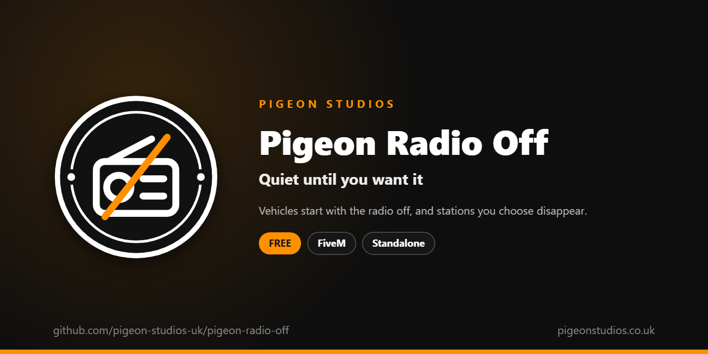

<div align="center">
  

  <h1>Pigeon Radio Off</h1>

  <p><strong>Vehicles start with the radio off, some vehicles have no radio at all, and stations you choose are taken off the wheel.</strong></p>

  <p>
    <a href="https://github.com/pigeon-studios-uk/pigeon-radio-off/releases/latest"></a>
    <a href="LICENSE.md"></a>
    <a href="https://discord.gg/2NFVWEUmDF"></a>
    
  </p>

  <p>
    <a href="https://github.com/pigeon-studios-uk/pigeon-radio-off/releases/latest"><strong>Download</strong></a> ·
    <a href="#installation">Install</a> ·
    <a href="#configuration">Configure</a> ·
    <a href="CHANGELOG.md">Changelog</a> ·
    <a href="https://discord.gg/2NFVWEUmDF">Support</a>
  </p>
</div>

---

## Contents

- [Overview](#overview)
- [Features](#features)
- [Requirements](#requirements)
- [Installation](#installation)
- [Updating](#updating)
- [Configuration](#configuration)
- [How it works](#how-it-works)
- [Update checker](#update-checker)
- [Performance](#performance)
- [Security](#security)
- [Troubleshooting](#troubleshooting)
- [FAQ](#faq)
- [Support](#support)
- [Contributing](#contributing)
- [Licence](#licence)
- [Credits](#credits)

## Overview

Pigeon Radio Off is a free resource by [Pigeon Studios](https://pigeonstudios.co.uk) that gives players the radio back as a choice. In GTA, the radio blasts the moment anyone gets in a car, which talks over voice chat in every traffic stop, every pursuit and every scene. Police cars and ambulances play pop music too.

With this resource, the radio is off when a player gets in to drive, and only plays when they turn it on. Vehicles you choose, such as police cars and ambulances, have no radio at all, and stations you don't want on your server, such as the talk stations, can be taken off the wheel completely.

## Features

- **Off when you get in.** The radio is switched off when a player gets in to drive. They turn it on when they want it.
- **No radio where it doesn't belong.** Whole vehicle classes, such as emergency vehicles, or single vehicles by spawn name, have no radio, in any seat.
- **Stations taken off the wheel.** Hide any station from everyone, so it's never heard in vehicles or anywhere else.
- **Players still choose.** Once they're in, the radio works as normal, unless the vehicle has none.
- **Undoes itself.** Stopping the resource puts every station and radio back.
- **Standalone.** No framework or other resources needed.

## Requirements

| Requirement | Version | Notes |
|---|---|---|
| FXServer | A [recommended artifact](https://runtime.fivem.net/artifacts/) | |

**Frameworks:** none needed. It works the same on standalone and vMenu servers, ESX Legacy, QBCore, Qbox and ox_core.

## Installation

1. **Download** `pigeon-radio-off.zip` from the [latest release](https://github.com/pigeon-studios-uk/pigeon-radio-off/releases/latest). Don't use the green **Code** button; release zips are the tested builds.
2. **Extract** it into your server's `resources` folder. The folder must be called `pigeon-radio-off`.
3. **Start it** by adding this to `server.cfg`:

   ```cfg
   ensure pigeon-radio-off
   ```

4. **Configure** it in `configuration/config.lua`. Out of the box, the radio starts off and nothing else changes.
5. **Restart** your server. The console shows one line from the update checker:

   ```text
   [Pigeon Studios] Pigeon Radio Off v1.0.0 is up to date.
   ```

## Updating

1. Read the [changelog](CHANGELOG.md) for every version between yours and the latest, especially any **Upgrade notes**.
2. Back up your `configuration/` folder.
3. Replace the `pigeon-radio-off` folder with the new release.
4. Copy your changed settings into the new `configuration/config.lua`. Don't copy the old file over the new one; new versions can add settings.
5. Restart the resource.

## Configuration

All settings are in `configuration/config.lua`, each explained by a comment next to it.

| Setting | Default | What it does |
|---|---|---|
| `Config.StartOff` | `true` | Switch the radio off when a player gets in to drive |
| `Config.NoRadioClasses` | `{}` | Vehicle classes with no radio at all, by number |
| `Config.NoRadioVehicles` | `{}` | Vehicles with no radio at all, by spawn name |
| `Config.HiddenStations` | `{}` | Stations taken off the radio wheel for everyone, by internal name |

**No radio in emergency vehicles:**

```lua
Config.NoRadioClasses = { 18 }
```

**Vehicle classes:** 0 compacts · 1 sedans · 2 SUVs · 3 coupes · 4 muscle · 5 sports classics · 6 sports · 7 super · 8 motorcycles · 9 off-road · 10 industrial · 11 utility · 12 vans · 13 cycles · 14 boats · 15 helicopters · 16 planes · 17 service · 18 emergency · 19 military · 20 commercial · 21 trains · 22 open wheel.

**Hiding stations.** Use each station's internal name, from [FiveM's list of radio stations](https://docs.fivem.net/docs/game-references/radiostations/). For example, to take the two talk stations off the wheel:

```lua
Config.HiddenStations = {
    'RADIO_05_TALK_01',   -- West Coast Talk Radio
    'RADIO_11_TALK_02',   -- Blaine County Radio
}
```

## How it works

While the player is in a vehicle, twice a second the resource checks which vehicle they're in and whether they're driving.

- **Getting in to drive.** It switches the radio off (`SetVehRadioStation` with `OFF`). GTA switches the radio on again as the engine starts, so for the first two seconds it keeps switching it off. After that, the radio is the player's to turn on.
- **A vehicle with no radio.** The first time the player is in it, the radio is disabled (`SetVehicleRadioEnabled`) and switched off, whatever seat they're in.
- **Hidden stations.** When the resource starts, each station in `Config.HiddenStations` is locked (`LockRadioStation`), which takes it off the wheel and stops it playing anywhere.

When the resource stops, hidden stations are unlocked and every radio it disabled is enabled again.

## Update checker

When it starts, Pigeon Radio Off checks our public [version registry](https://github.com/pigeon-studios-uk/pigeon-versions) once and prints one line in the server console saying whether it's up to date. If there's an update, it shows what's new and where to get it. The check is a single request to GitHub and sends nothing about your server or players.

Control it for every Pigeon Studios resource at once in `server.cfg`:

```cfg
set pigeon_update_check "on"      # default: one line per resource
set pigeon_update_check "quiet"   # only when there's an update or a problem
set pigeon_update_check "off"     # never check
```

## Performance

It checks twice a second while in a vehicle, and four times a second for the two seconds after getting in to drive. Nothing runs every frame, and nothing runs on the server apart from the update check at start-up.

## Security

- It runs only in each player's own game and only changes the radio they hear.
- It has no commands, exports or network events, so there is nothing other players, other resources or the server can send it.
- The only network request is the update check at start-up, from the server to GitHub. It sends nothing about your server or players.

Found a problem? Please don't open a public issue. Use the **Report a vulnerability** button in this repository's **Security** tab, or follow our [Security Policy](https://github.com/pigeon-studios-uk/.github/blob/main/SECURITY.md).

## Troubleshooting

**The radio still comes on when I get in.**
Check the resource is started and there are no errors in the F8 console, and `Config.StartOff` is `true`. A vehicle or radio resource that sets the station itself can switch it back on; use one or the other for radio.

**A hidden station still plays.**
Check the name exactly matches FiveM's list, including capitals, and restart the resource.

**Passengers can still change the station.**
That's GTA's own radio. To stop radio in a vehicle completely, add it to `Config.NoRadioVehicles`, or its class to `Config.NoRadioClasses`.

**The console says "isn't in the version registry" or "couldn't check for updates".**
Your server couldn't reach GitHub, or the check is blocked by a firewall. The resource works normally either way. Turn the check off with `set pigeon_update_check "off"`.

## FAQ

**Is it really free?**
Yes. Use it on as many servers as you like, including ones that take donations. You just can't reupload, resell or bundle it. See [Licence](#licence).

**Does it work on standalone and vMenu servers?**
Yes. It needs no framework at all, and works alongside vMenu. vMenu's own radio options still work.

**Does it change the radio for other players in the car?**
The station a car plays is shared by everyone in it, so turning it off when you get in to drive turns it off for your passengers too.

**Can it silence the police scanner and distant sirens too?**
That's [Pigeon Quiet City](https://github.com/pigeon-studios-uk/pigeon-quiet-city).

## Support

Read [Troubleshooting](#troubleshooting) first, then ask in the support channels of our [Discord](https://discord.gg/2NFVWEUmDF). Please include your Pigeon Radio Off version, FXServer artifact and any errors from the console (F8 in game). See [Getting help](https://github.com/pigeon-studios-uk/.github/blob/main/SUPPORT.md).

Found a bug? Open a [bug report](https://github.com/pigeon-studios-uk/pigeon-radio-off/issues/new/choose).

## Contributing

Fixes and improvements are welcome. Please read the [contributing guide](https://github.com/pigeon-studios-uk/.github/blob/main/CONTRIBUTING.md) first, and open a feature request before working on anything big.

## Licence

Pigeon Radio Off is free to use under the **[Pigeon Studios Free Licence](LICENSE.md)**.

- ✅ Use it on any number of servers, including monetised ones
- ✅ Change it for your own servers
- ✅ Show it in videos and streams
- ❌ Don't reupload, share or mirror the files; link to this repository instead
- ❌ Don't sell it, bundle it in packs, or put it behind escrow
- ❌ Don't remove the credits

This summary isn't the licence; [LICENSE.md](LICENSE.md) is. Third-party components are listed in [NOTICE.md](NOTICE.md).

## Credits

Made by [Pigeon Studios](https://pigeonstudios.co.uk). Thanks to everyone who has contributed fixes; see the [changelog](CHANGELOG.md).

<sub>Not affiliated with or endorsed by Rockstar Games, Take-Two Interactive or Cfx.re.</sub>
